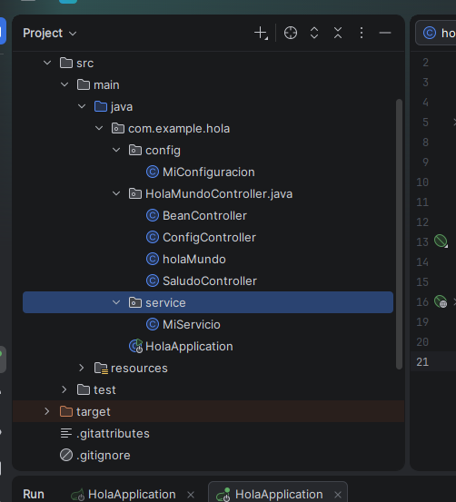
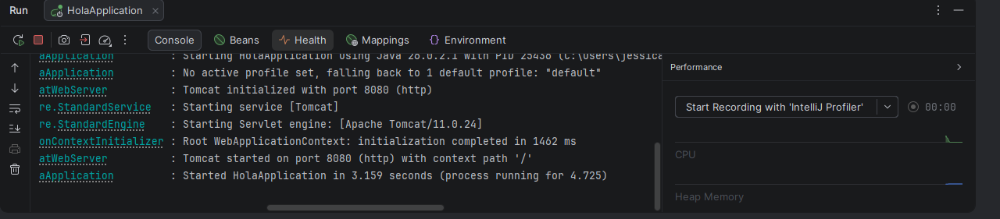
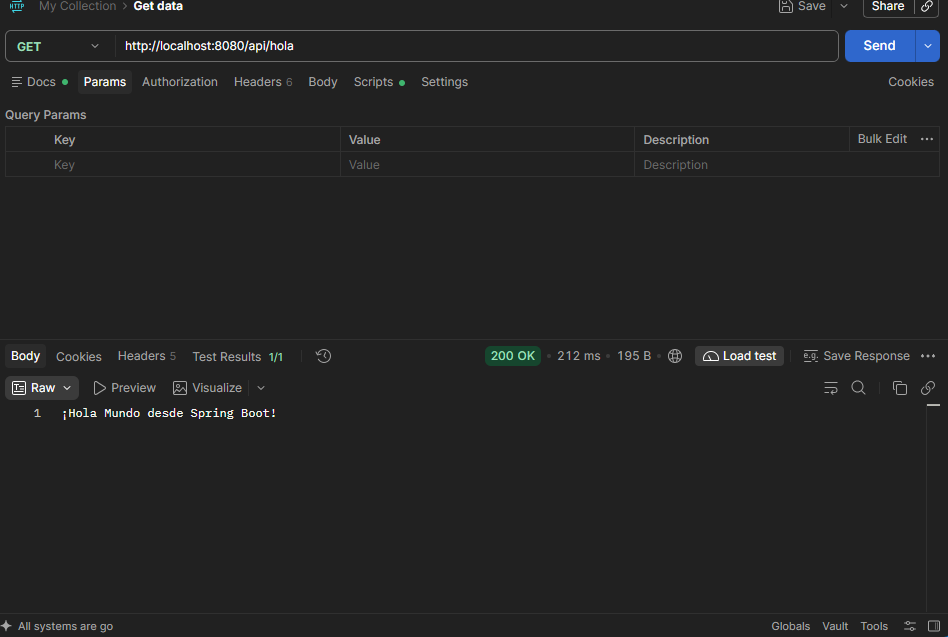
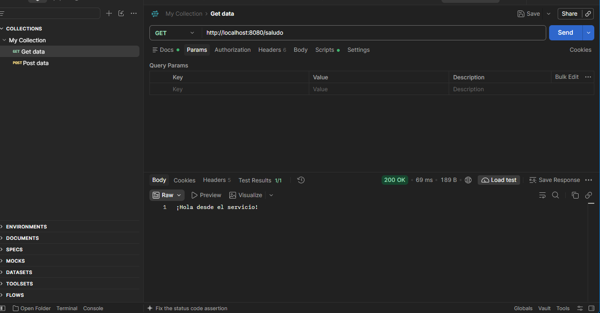
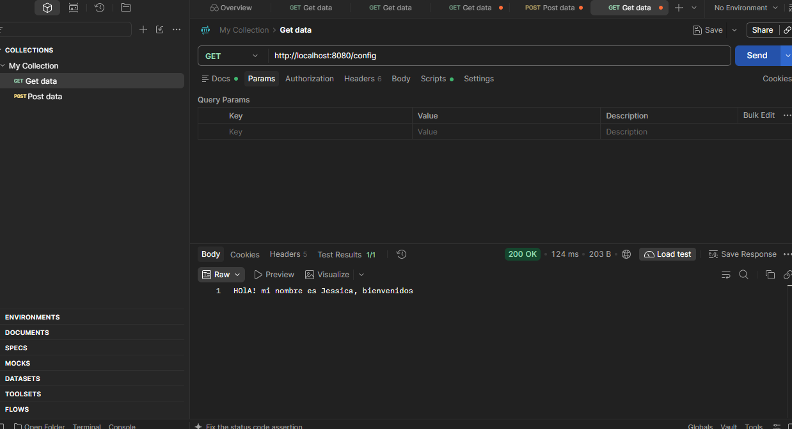
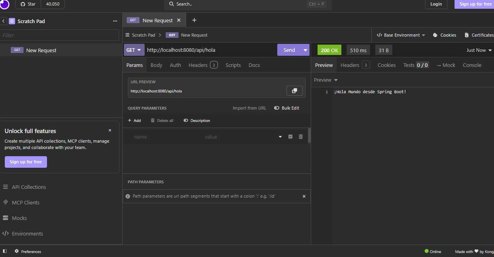
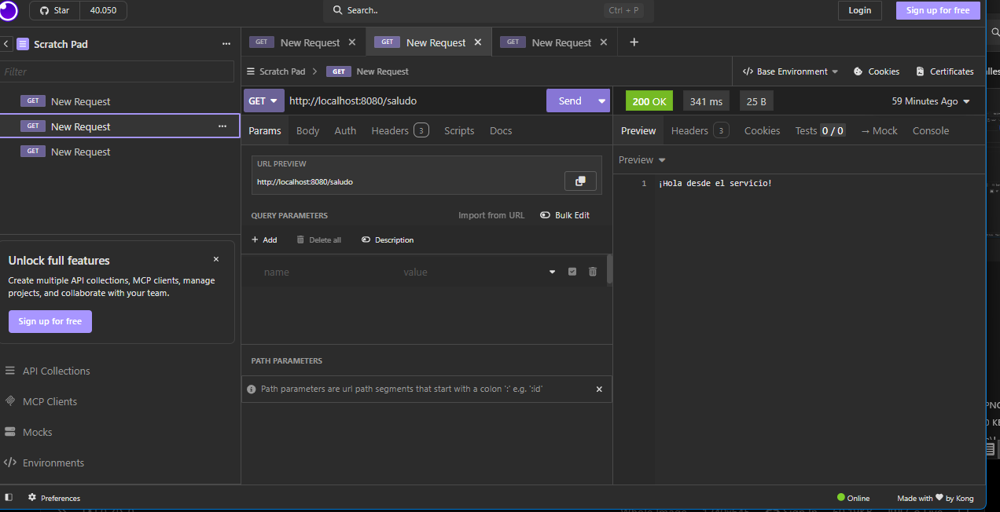
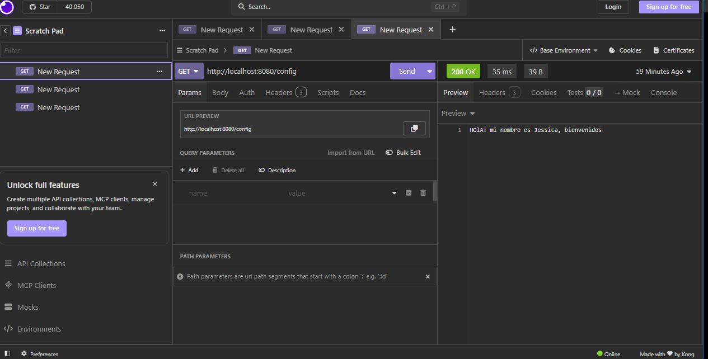
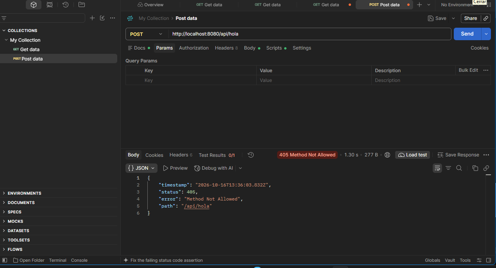
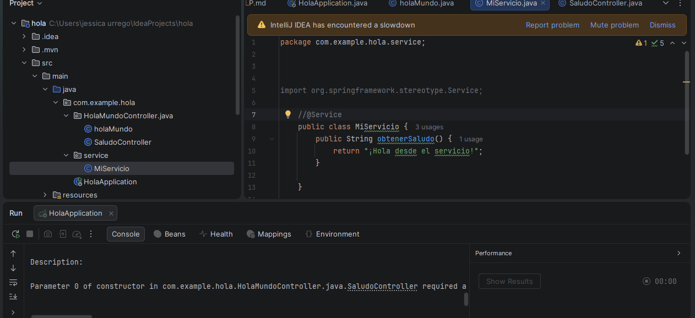

# 🌱 Hola Mundo con Spring Boot

## 📌 Descripción del proyecto

Este proyecto consiste en el desarrollo de una aplicación web básica utilizando Java y Spring Boot. El propósito es aprender a crear servicios REST, configurar controladores, implementar servicios e inyección de dependencias y probar endpoints HTTP mediante Postman e Insomnia.

## 🎯 Objetivos

- Crear y ejecutar un proyecto Spring Boot.
- Comprender el funcionamiento de `@SpringBootApplication`.
- Crear endpoints utilizando `@RestController` y `@GetMapping`.
- Implementar servicios con `@Service`.
- Aplicar inyección de dependencias mediante constructores.
- Leer propiedades externas con `@Value`.
- Registrar objetos mediante `@Configuration` y `@Bean`.
- Probar endpoints HTTP con Postman e Insomnia.
- Identificar errores HTTP y errores de configuración de Spring.

## 🛠️ Tecnologías utilizadas

- **Java:** JDK 17 o superior, según la configuración del proyecto.
- **Spring Boot:** framework para desarrollar aplicaciones Java.
- **Spring Web:** creación de controladores y servicios web REST.
- **Maven:** administración de dependencias.
- **IntelliJ IDEA:** entorno utilizado para crear y ejecutar el proyecto.
- **Visual Studio Code:** edición de archivos y documentación.
- **Postman:** pruebas de peticiones HTTP.
- **Insomnia:** pruebas de servicios REST.
- **Git y GitHub:** control de versiones y publicación del proyecto.

## 📁 Estructura del proyecto

```text
holamundo/
├── capturas/
│   ├── 01-estructura-proyecto.png
│   ├── 02-tomcat-iniciado.png
│   ├── 03-postman-api-hola.png
│   ├── 04-postman-saludo.png
│   ├── 05-postman-config.png
│   ├── 06-insomnia-api-hola.png
│   ├── 07-insomnia-saludo.png
│   ├── 08-insomnia-config.png
│   ├── 09-error-405.png
│   └── 10-error-service.png
├── src/
│   ├── main/
│   │   ├── java/
│   │   │   └── com/ejemplo/holamundo/
│   │   │       ├── HolamundoApplication.java
│   │   │       ├── controller/
│   │   │       │   ├── HolaMundoController.java
│   │   │       │   ├── SaludoController.java
│   │   │       │   ├── ConfigController.java
│   │   │       │   └── BeanController.java
│   │   │       ├── service/
│   │   │       │   └── MiServicio.java
│   │   │       └── config/
│   │   │           └── MiConfiguracion.java
│   │   └── resources/
│   │       └── application.properties
│   └── test/
├── pom.xml
└── README.md
```

*Nota: esta es la estructura esperada al completar todos los retos. La carpeta `capturas` debe crearse para guardar las evidencias.*

## 🚀 Ejecución del proyecto

1. Abrir el proyecto en IntelliJ IDEA.
2. Verificar que el JDK esté configurado correctamente.
3. Esperar a que Maven descargue las dependencias.
4. Ejecutar `HolamundoApplication.java`.
5. Comprobar en la consola que Tomcat inició en el puerto 8080.
6. Utilizar Postman o Insomnia para probar los endpoints.

### Evidencia 1. Estructura del proyecto



### Evidencia 2. Servidor iniciado



## 🔗 Endpoints implementados

| Método HTTP | Endpoint | Descripción |
|---|---|---|
| GET | `/api/hola` | Devuelve un mensaje de Hola Mundo. |
| GET | `/saludo` | Devuelve un mensaje obtenido desde un servicio. |
| GET | `/config` | Devuelve un mensaje definido en la configuración externa. |

### 1. Endpoint Hola Mundo

**URL:** `http://localhost:8080/api/hola`

**Respuesta esperada:**

```text
¡Hola Mundo desde Spring Boot!
```

### 2. Endpoint Saludo

**URL:** `http://localhost:8080/saludo`

**Respuesta esperada:**

```text
¡Hola desde el servicio!
```

Este endpoint utiliza `MiServicio`, que es inyectado en `SaludoController` mediante su constructor.

### 3. Endpoint Configuración

**URL:** `http://localhost:8080/config`

**Respuesta esperada:**

```text
¡Bienvenido a Spring Boot!
```

El mensaje se obtiene de la propiedad `mensaje.bienvenida`, definida en `application.properties` y leída mediante `@Value`.

## 🧪 Pruebas en Postman

Las siguientes evidencias deben mostrar la petición GET, la URL y el estado HTTP **200 OK**.

### Prueba 1. GET /api/hola



### Prueba 2. GET /saludo



### Prueba 3. GET /config



## 🧪 Pruebas en Insomnia

Se realizaron pruebas de los mismos endpoints utilizando Insomnia para verificar sus respuestas HTTP.

### Prueba 1. GET /api/hola



### Prueba 2. GET /saludo



### Prueba 3. GET /config



## ⚠️ Retos y manejo de errores

### Reto 1. Método HTTP incorrecto: 405 Method Not Allowed

Se realizó una petición utilizando un método HTTP diferente al permitido por el endpoint.

Por ejemplo, enviar una petición POST a `/api/hola`, que está definido para recibir GET, puede generar una respuesta **405 Method Not Allowed**.

Este error indica que el servidor reconoce la ruta, pero el método HTTP utilizado no está permitido para ella.



### Reto 2. Eliminar la anotación @Service

Se eliminó temporalmente la anotación `@Service` de la clase `MiServicio` para observar el comportamiento de Spring Boot.

Al ejecutar la aplicación, Spring no pudo encontrar el componente requerido por el constructor de `SaludoController` y la aplicación no pudo iniciarse correctamente.

Después de volver a agregar `@Service`, la aplicación pudo reconocer el servicio nuevamente.



## ⚙️ Configuración de un Bean

Se creó la clase `MiConfiguracion` utilizando `@Configuration` y `@Bean` para registrar un objeto de tipo `String`.

El objeto se inyecta en `BeanController` mediante el constructor y se expone en el endpoint:

**GET:** `http://localhost:8080/bean`

**Respuesta esperada:**

```text
¡Este es un mensaje de un bean!
```

## 📚 Respuesta conceptual

### ¿Qué diferencia hay entre @RestController y @Service?

`@RestController` se utiliza para recibir peticiones HTTP y devolver respuestas al cliente, como mensajes de texto o datos JSON.

`@Service` identifica una clase que contiene lógica de negocio y que Spring administra como un componente de la aplicación.

### ¿Por qué Spring puede entregar el servicio al controlador sin usar new?

Spring utiliza un contenedor de inversión de control que administra los objetos de la aplicación. Cuando detecta `@Service`, registra el componente y puede inyectarlo automáticamente en el constructor del controlador.

Esto se conoce como **inyección de dependencias**. Permite reducir el acoplamiento entre las clases y facilita el mantenimiento y las pruebas del código.

## 🌐 Publicación en GitHub y DeepWiki

1. Crear un repositorio público en GitHub.
2. Subir el código fuente, el archivo `pom.xml`, las capturas y este README.
3. Verificar que el repositorio sea accesible públicamente.
4. Abrir DeepWiki y localizar el repositorio publicado para generar o consultar su documentación, si el servicio lo admite.

**Repositorio de GitHub:** [Agregar aquí el enlace del repositorio]

**Documentación DeepWiki:** [Agregar aquí el enlace generado, si está disponible]

## ✅ Conclusiones

Esta actividad permitió conocer los fundamentos de Spring Boot, la creación de servicios REST, la separación entre controladores y servicios y la inyección de dependencias. Además, se practicaron las pruebas de endpoints HTTP con Postman e Insomnia y la identificación de errores como 405 Method Not Allowed.

Finalmente, se preparó el proyecto para su documentación y publicación mediante GitHub, fortaleciendo las habilidades de desarrollo y control de versiones.
